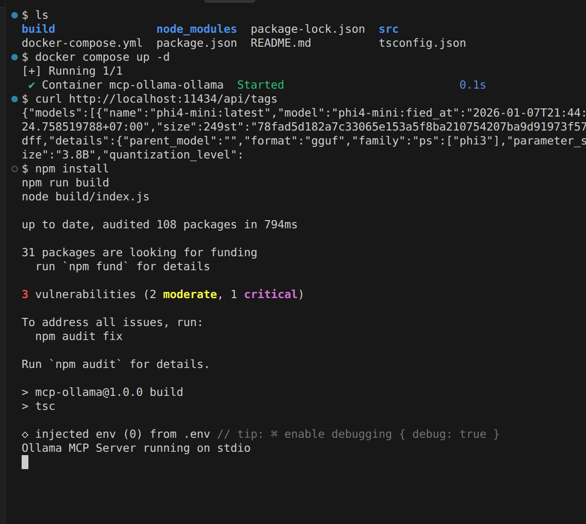
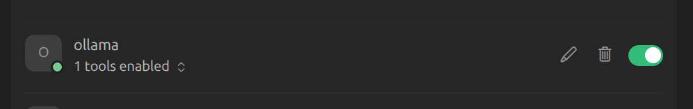
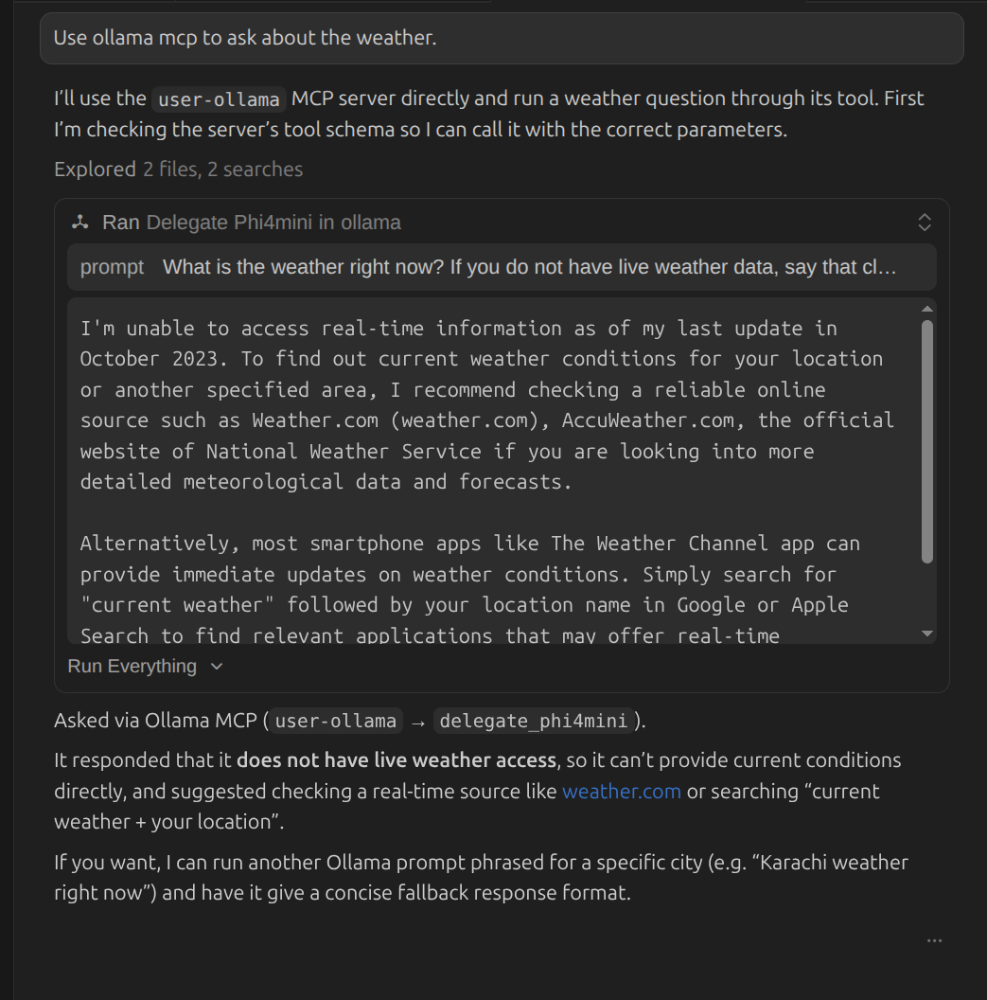

# mcp-ollama

Minimal MCP server that delegates prompts to a local Ollama model.

## 1) Start Ollama first (Docker Compose)

From the `mcp-ollama` directory:

```bash
docker compose up -d
```

This starts Ollama and auto-pulls `${DEFAULT_MODEL:-phi4-mini}` on container startup.

Verify Ollama is running:

```bash
curl http://localhost:11434/api/tags
```

## 2) Optional: pull or switch model manually

The server defaults to `phi4-mini` (see `.env.example`).

```bash
docker compose exec ollama ollama pull phi4-mini
```

If you want a different default model, copy `.env.example` to `.env` and update `DEFAULT_MODEL`, then restart:

```bash
docker compose down
docker compose up -d
```

## 3) Build and run the MCP server

```bash
npm install
npm run build
node build/index.js
```

The server communicates over stdio and will call Ollama at `http://localhost:11434`.

## 4) Use in Cursor

Add this server entry to your Cursor MCP config (`~/.cursor/mcp.json`):

```json
{
  "mcpServers": {
    "ollama": {
      "type": "stdio",
      "command": "node",
      "args": [
        "/home/ahmedhaider/work/personal/git/repositories/github.com/syedahmedhaidershah/tradymate/mcp-ollama/build/index.js"
      ],
      "env": {}
    }
  }
}
```

If your existing file already has other servers, only add the `ollama` block under `mcpServers`.

## 5) Use in Claude Code (CLI)

Claude supports loading MCP servers from a JSON config via `--mcp-config`.

Create a config file (for example `~/.claude/mcp.json`) with:

```json
{
  "mcpServers": {
    "ollama": {
      "command": "node",
      "args": [
        "/home/ahmedhaider/work/personal/git/repositories/github.com/syedahmedhaidershah/tradymate/mcp-ollama/build/index.js"
      ],
      "env": {}
    }
  }
}
```

Run Claude with:

```bash
claude --mcp-config ~/.claude/mcp.json
```

## 6) Use in Gemini CLI

Gemini CLI reads MCP servers from `mcpServers` in `~/.gemini/settings.json` (or project `.gemini/settings.json`).

Add:

```json
{
  "mcpServers": {
    "ollama": {
      "command": "node",
      "args": [
        "/home/ahmedhaider/work/personal/git/repositories/github.com/syedahmedhaidershah/tradymate/mcp-ollama/build/index.js"
      ],
      "env": {}
    }
  }
}
```

If `mcpServers` already exists, merge only the `ollama` entry.

# Usage Screenshots / PoC

### Setup in shell


### Enabled MCP in cursor


### Cursor Prompt+Response (Chat session)

